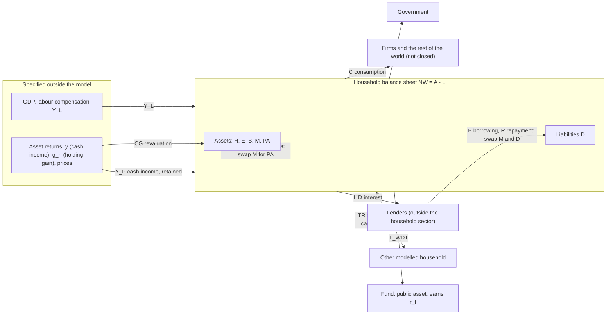

# 094r: what the v3 kernel does with consumption, returns and WDT today, and a household account that would replace the universal drawdown

Accessed 2026-11-21. Brief `docs/briefs/094r-kernel-map-and-household-accounts.md`; follows 093r (`research/notes/093r-consumption-depletion-evidence.md`) and the hypothesis `research/hypotheses/household-consumption-and-wealth-replenishment.md` (sections 10 to 14). Design only: no code, register, manifest, schedule, retirement-rule or fund-rule change comes from this note. Line numbers are those of `origin/main` at commit 7e3379f.

## Answer in brief
- **Part A.** I-D14c enters the kernel in one place, `grow_and_consume` (`model/model_v3/core/kernel.py:324-341`), as a proportional sale of a share c of every route's remaining family units after growth, for every line, band and route alike. Nothing else in the kernel is a household flow: there is no income, saving, liability, pension, gift or cash-income term. Returns are one total real arithmetic return. WDT leaves private wealth as units moved to the state's stake, and the revenue code reads the same payment as a cash flow into a separate fund; the two representations of the public asset are not linked. WDT is assessed **after** c in the year's order of steps.
- **Dependence on 3.5%.** Every output that runs the kernel (all but the pack and register facts) moves with c, directly or through the fund and retirement rules; the full table is in A5. The committed reports 083c and 090c rest on 3.5% as their central; 090c is the only one that varies it. No committed run output exists yet.
- **Part B.** The identity `dNW = S + CG + TR + O - T_WDT` is specified with a flow-of-funds diagram, a variable dictionary and a worked illustrative household in which each case in the brief reconciles by arithmetic, in the stock form and the flow form. Under a total-return credit, `S` is defined as net saving **including retained cash income once**, and the kernel's growth step must then credit only the holding-gain part `g_h`, or credit `r = y + g_h` and leave `y` out of `S`.
- **No scalar is proposed.** 3.5% is a legacy comparator only (author decision, 2026-11-20). Numbers in B3 are for one illustrative household and are not data or values for any band.

---

## A. The kernel as it is (read only)

### A1. Where I-D14c enters, and what it does to units, base and routes
- **Register to kernel.** The register row I-D14c (central 3.5, low 0.5, high 5, % of net worth a year, judgement; `docs/model-v3/inputs.md:304`) is listed in the runner's `RUN` ids (`model/model_v3/runner/runner.py:52`) and read as `c = theta['I-D14c'] / 100` (`runner.py:202`). It is a register row only: **`levers.json` has no mapping for it and the pack holds nothing for it** (no match for `I-D14` or `consumption` as a pack pointer in `model/model_v3/levers.json`; the "consumption" entry at `levers.json:590` is the tax group `vat, fuel_duty`, unrelated). The same `c` reaches the kernel through three callers: `burden.line_flows` (`burden.py:86`, `106`), `revenue.run_lines` (`revenue.py:53`, `83`, `87`) and `support.wdt_run` / `system_run` (`support.py:120-134`, `150-155`).
- **The form.** `grow_and_consume(book, g, consumption)` (`kernel.py:324-341`): for each route r, `Vn = V (1 + g)`; the family's growth is `f (Vn - V)`; then `cu = f c` units are sold at the grown price, `consumed = cu Vn`, `f <- f - cu`. So per route the family's value follows `W[t+1] = W[t] (1 + g)(1 - c)`, as 093r section 1 states, and the state's units `s` are not consumed. The revenue code repeats the form for payer status: `W1 = W0 (1 + g)(1 - c)` (`revenue.py:83`).
- **Units.** Consumption is a fraction of the family's units, `f` falling geometrically; `sold` accumulates (`kernel.py:337-338`). The consumed value is recorded in `Flows.consumed` and then **nothing reads it** (a search of `model_v3/` and `tests/model/model_v3/` finds `consumed` only in the kernel and its own flow record). It is a sink: it is income to no one, adds to no GDP and no fund.
- **Base.** `build_base` (`base.py:116-149`) has no consumption argument. It builds the launch wealth of 14 lines from the pack's `wealth_total`, and splits it into routes by register shares (`base.py:147`). The base is therefore independent of c; c acts on every line, including lines below the threshold W_min and including pension and housing wealth, because the pack's total wealth is the whole household balance sheet (`model_v3/pack/build_gbr.py:70-77`: blocks 0 total, 1 property, 2 financial, 4 pension).
- **Routes.** The same c applies to every route (A to D, and Cv) because the loop is over `book.routes` with one `c` per line (`kernel.py:331-338`); there is no route-specific or band-specific consumption.
- **Elsewhere c is used outside the kernel.** `burden.free_path` (`burden.py:173-176`: `(1+g)(1-c)` for the untaxed path, used by OH1b and OH1c, `burden.py:186-216`), `support.system_run` (`support.py:120-134`: the comparators' terminal wealth, with `consumption_tax = rate c grown`), `revenue.identity` (`revenue.py:236-246`: the accrued gain rate `(1+r)(1-c)-1`), and the diagnostics in 090c, which override it.

### A2. How returns are credited
- **One total real arithmetic return.** Paths are "real annual ARITHMETIC returns as fractions ... V -> V (1 + g)" (`model/model_v3/core/returns.py:9-13`); the real return is `(1 + capital_tr)/(1 + CPI inflation) - 1` from the pack's returns table (`returns.py:33-38`). The central is I-D1a, 4.74 (`inputs.md:127`). The pack's `returns.csv` carries only `eq_tr, housing_tr, bond_tr, capital_tr, cpi, gdp_pc`, total returns; the JST source file it was built from does hold the split variables (`eq_div_rtn`, `housing_rent_rtn`, `eq_capgain`, `housing_capgain`, `bond_rate`, `bill_rate` among the 56 variables listed in `data/country-packs/GBR/source/jst_r6.json`'s `meta`), but nothing in the pack tables or the kernel reads them.
- **No separate cash-income term.** The kernel has no term for cash property income apart from gains: income and gain are one number, credited to wealth, inside `Vn = V (1 + g)` (`kernel.py:333`).
- **Income, saving and consumption flows.** None, except c. Two things look like income and are not: (i) `Book.inc_allow` (`kernel.py:116`, `139`, `229-244`, `457`) is an allowance of external income that can pay Route B WDT when `b_mode == 'income'`; the default is `b_mode='sale'` (`kernel.py:120`) and `runner.py` passes no `book_kw` for it, so it is off in the runs; and when on it pays tax from outside the wealth stock, adds nothing to it. (ii) `base.income` and `base.liquid` (`base.py:141-142`) are per-line denominators for M2b and M2c (`burden.py:148-155`); they never enter the kernel and are `nan` below D4 (`base.py:144-145`).

### A3. How WDT payments leave private wealth, the public side, and the order of steps
- **Private side.** A payment moves units from the family to the state: `_move` (`kernel.py:191-197`: `f -= units; s += units`), so private wealth `family_true()` (`kernel.py:164-166`) falls by the tax. Route A and Route B pay by `_route_tax` (`kernel.py:219-`), refunds come back by `_refund_cash` (`kernel.py:209-216`), capped by the pooled cash envelope and the state's stake (`kernel.py:213`).
- **Public side, two representations that are not linked.** (a) Inside the book, the state's units `s` grow at g (`growth_state`, `kernel.py:329`) and `state_true()` exists (`kernel.py:167`); **no module outside the kernel reads `state_true`, `state_cash` or `growth_state`** (search of `model_v3/`; tests only: `tests/model/model_v3/test_kernel.py:32`, `137`, `250` and `test_revenue.py:157`). (b) In the revenue code the same payment is the cash flow `wdt = tax + refund + death_tax + heir + death_B + death_D` (`revenue.py:207`) and goes into the fund with the corporate levy: `fund(wdt + lev, E, g, ...)` (`revenue.py:208`). The fund pays out `R` against expenditure `E`, earns `r = g` (the same random real return as private wealth; `safe_share`, I-D14f central 0, mixes in a safe return; `fund`, `revenue.py:121-160`), and M1c is its income net of retention (`revenue.py:210`).
- **Retirement and fund rules.** `retire(relief, fill, rec)` (`revenue.py:174`) retires the lines of receipts in ascending order once the fund is full and relief covers them; the fund fills by `pre >= total target` (`revenue.py:139-146`). The retired taxes' own incidence is `burden.incidence` (`burden.py:219-`).
- **Order within a year** (`kernel.py:450-475`): lien accrual, then `grow_and_consume`, then `declare`, then verification, then **one assessment** `assess` on total declared wealth, then settlement per route, then `rebase`. So WDT is assessed on the change in declared wealth **after** consumption has reduced it (`kernel.py:8-9`, `458-467`): c comes first and its fall in W reduces the taxable delta, consistent with plan decision D17 (`docs/VAL_generational_model_plan.md:73`, "consumption is a loss of net worth and earns a refund, bounded by the lifetime envelope"). The headline M1a identity is built the same way: `eps x g_acc x omega` with `g_acc = (1+g)(1-c) - 1` (`revenue.py:241`).
- **WDT is not consumption in the kernel**, but because the state's stake and the fund are not tied, aggregate wealth inside the kernel falls by the tax while the fund's balance is rebuilt separately from the flow. No consolidated household-plus-public account is checked anywhere.

### A4. Pensions, liabilities, gifts and bequests
- **Pensions: in the wealth, not in the kernel.** The pack's `wealth_total` includes private pension wealth (WAS block 4, `build_gbr.py:70-77`); `pension_share` by band is kept (`wealth_distribution.csv`, four rows plus "all") but is read only by M12 to size the exempt-by-law escape (`burden.py:203`, `207`). In the kernel pension wealth is part of the family's units: grown at g, consumed at c, taxable like any other wealth. There is no contribution, accrual, decumulation or annuitisation.
- **Liabilities: not represented.** No household debt exists in the kernel or the pack; the pack's variable is `net_financial_share` (`wealth_distribution.csv`), so any liability is netted out of the launch wealth and cannot move afterwards. The only "liabilities" in the kernel are WDT ones: the deferred-balance lien `LB` accruing at `r_def` (`kernel.py:453`) and Route D accruals. Consumption cannot be financed by borrowing; every unit of c is a sale of existing units.
- **Gifts: not represented** in the kernel (plan decision D20, `docs/VAL_generational_model_plan.md:76`: gifts accepted and no gift axis in the baseline; D17 would have taxed the receiver and refunded the giver).
- **Bequests: one heir rule.** `step_death` (`kernel.py:478-512`), every G = 30 years (`burden.py:109-112`, `revenue.py:100`), verifies Route C, auctions Route D, settles the deferred balance, **clears the envelopes**, and taxes the heir on the receipt as a delta from zero: `assess(book, rate_fn, idx, Wn, {r: 0 ...})` (`kernel.py:507-511`). The same book carries on (one heir per generation, no splitting, no inheritance tax in the kernel: IHT is a retired tax only on the receipts side). v2's `heir_rule = "fresh"` ablation (`model_v2/WDT_Params.toml:724`) is dropped: "the only heir rule" (`kernel.py:26`). Plan D6 (the heir's receipt is "simply a rise in net worth between two assessments", `VAL_generational_model_plan.md:62`) is what the code implements; plan D6 in the kernel header (`kernel.py:42`) is a different D6, the verification hazard.

### A5. Outputs and prior results that depend on 3.5%
Mechanisms: **K** the kernel path runs with c (`core_run`, `runner.py:195-215`); **F** through the fund fill, the retirement years or feasibility (P-series), because `wdt` depends on K; **S** a separate path that also uses c; **0** no dependence (pack or register only). Source of each: `outputs.yml` ids; groups `out_revenue.py`, `out_burden.py`, `out_support.py`, `out_sweeps.py`.

| Id | Metric | Depends on c? | Mechanism |
|---|---|---|---|
| O1, O1a | M1, M1a | yes | K: tax base `W (1+g)(1-c)`, payer status `pay1` (`revenue.py:83-84`); death flows on the drained stock |
| O1b | M1b | no, directly | corporate levy is a constant percent of GDP (`revenue.py:210`); it does enter the fund, so P-series move |
| O1c | M1c | yes | F: fund balance depends on `wdt` (`revenue.py:208-210`) |
| O1d | M1e | yes | F: retired taxes' lines depend on the retirement years (`revenue.py:174`) and the fill |
| O1e, O1f | M1f, M1g | yes | K: each break-even evaluation reruns the kernel at c (`sweeps.py`, breakeven) |
| O2, O2d, O2b, O2c | M2, M2d, M2b, M2c | yes | K: `net / w0`, w0 falls with c (`burden.py:122-155`) |
| O3 | M3 | yes | K: `delta` (real change in net wealth after c) and `net` (`burden.py:165-170`) |
| O4a, O4b, OL1 | M4a, M4b, M4c | yes | F: years each tax is retired (`burden.py:m4` reads `P5`), so through the fund |
| O5 | M5 | partly | the comparators' burden is register only; the `diff` against M2 moves (`out_burden.py` docstring, O5) |
| O6 | M6 | no | register rows I-M6a to I-M6i only |
| O7, OD1 | M7 | no found | the declaration curve takes a Route C line of I-D14h pounds and the schedule's rate; I found no `consumption` argument in `declaration_runs`; not run to confirm |
| OP1, OP3, OP4, OP5, OP6, OR1 | P1, P3 to P7 | yes | F: fund fill, shortfall, solvency from `wdt` (`revenue.py:208-246`) |
| O8 | M8 | yes | M1 times GDP per path (`out_burden.py` docstring, O8); shares independent |
| OS1 | S1 | yes | K: `s1_effect` on a rerun (`support.py:232`) |
| OH1b | M3 (today) | yes | S: `m3_today` on `free_path` with c (`burden.py:186-190`; `out_burden.py:77`) |
| OH1b2 | M11 | no | register row I-T1d |
| OH1c | M12 | yes | S: `m12` on `free_path` with c (`burden.py:198-216`) |
| DH1a, DH1b, DH1c | data facts | no | pack only |
| OW1 | M13 | yes | S: `welfare` runs `wdt_run` and `system_run` with c for WDT and every comparator (`support.py:120-170`) |
| OW2 | M14 | no | `lockin` has no consumption term (`support.py:177`) |
| OW3 | M15a, M15b | yes | K: kernel rerun with per-year capture; drained wealth changes the refunds and the envelope |
| OB1 | B1 | yes | K: payer status, entries, exits and fall-through use `pay` and `pay1` (`revenue.py:83-100`) |
| OM1 | M9 | yes | S: `migration_effect` takes I-D14c (`out_support.py` docstring) |
| OF1 | F1 | yes | F: closure share over the schedule grid at central inputs, each point a kernel run (`sweeps.py:52-63`) |
| OT1 | T1 | yes, twice | every cell's central rests on c; and I-D14c is itself a tornado row (low 0.5, high 5): the swing is read from `sweeps.tornado` over the register rows (`sweeps.py:85-100`) |

Prior results that move with c:
- **083c** `docs/model-v3/f1-diagnostic/report.md`: all 27 grid points at central inputs with c = 3.5 (via `ctx.centre`, `f1_gap.py:62`, `106`); the closure shares (best 50.6%) and the structural statement that M1a falls from 11.3% of GDP in year 10 to 0.09% in year 100 (tm50) are results of the drawdown (also `docs/briefs/090c-wealth-ratio-diagnostic.md`).
- **090c** `docs/model-v3/wealth-ratio-diagnostic/report.md`: central 3.5 and the sweep 0, 0.5 to 5. At 3.5 wealth to GDP at year 100 is 0.47 with the tax on (0.62 with the tax off and c = 3.5); it is 1.00 at c of 2.65 to 2.67 (tm50 to tm90); relief falls by 1.22 to 1.53 GDP-points between the blocks ending in years 20 and 100 at 3.5 and rises 36.6 to 36.9 at c = 0 (report lines 3 to 11). First year relief falls below M1d: year 13 at 3.5 (report line 133-139). These are the report's own numbers; the author abandoned 3.5% as a central after they were written.
- **093r** `research/notes/093r-consumption-depletion-evidence.md`: no number depends on c; the mapping `c = (y - s)/(1 + r)` (section 3.2) assumes the kernel's form, and section 4's "gap to 3.5%" column compares against it.
- **041r tornado** (`docs/model-v3/tornado.md`, `tornado/`): runs the steady-state identity from the register; a search of `tornado.md`, `tornado.py` and `tornado_v2.py` finds no I-D14c row or consumption term, so it does not rest on 3.5%. I did not rerun it.
- **Tests that pin numbers from a c run**: `tests/model/model_v3/test_groups.py:11` (the Samples digest `ce75c164...`, seed 7, 40 paths); not listed individually.
- **No committed run output**: `model/model_v3/out/` holds `assemble.py` and `writer.py` only, so no provisional run result is on file to label; 057c's guru note asks `run.py` to write a field marking the run legacy (`docs/briefs/057c-v3-12-run-script-and-acceptance.md`, "Guru note 2026-11-20").

### A6. Inputs a flow model needs that the pack does not hold
| Needed | Held now | Nearest file | Gap |
|---|---|---|---|
| Income by wealth band | register rows I-D9a to I-D9d, D4 and above, nan below (`base.py:141`); income by income decile in `household_incidence.csv` (`gross_income`, 10 rows, FYE 2024) | `data/country-packs/GBR/household_incidence.csv` | no income by wealth band for D1 to D3; no labour/capital split; no joint income and wealth table (`burden.py` module note) |
| Consumption | none | `household_incidence.csv` (`total_tax` only); `public_expenditure.csv` (government) | no household spending, by band or in total |
| Liabilities | none; wealth is net | `wealth_distribution.csv` (`net_financial_share`, `property_share`) | no gross debt, mortgage, interest or repayment |
| Age, working or retired status | none in the pack; the held WAS workbook has age bands (Table 2.11) | `data/rates/totalwealthtables.xlsx` (not in the pack) | no age cell by wealth band in the pack |
| Pension wealth | `pension_share` by band (4 bands and all) | `wealth_distribution.csv` | share only; no contributions, accrual, state or defined-benefit split |
| Cash income against capital gain | total real return only | `returns.csv`; the split exists in `source/jst_r6.json` (`eq_div_rtn`, `housing_rent_rtn`, `eq_capgain`, `housing_capgain`) | the pack builder drops the components; not yet built into a table |
| Transfers (gifts, inheritances) | none; one heir rule | none | no flow data |
| Saving by band | register I-W3a to I-W3d (published saving rates, foreign and UK, `inputs.md:356-359`) | the register | no UK saving by wealth band (093r section 4) |

---

## B. The household accounts

### B1. The identity
For household (or cell) i in year t, in **real** pounds (the kernel's unit; B2 gives the nominal treatment):

`NW = Assets - Liabilities`

`dNW = S + CG + TR + O - T_WDT`   (hypothesis section 13)

with the accounting principles of hypothesis section 12 taken as given. In this note:
- `Assets = H + E + B + M + PA`: housing (owner-occupied, net of nothing), equities, bonds, cash and deposits, and the pension asset at market value (defined-contribution pot or valued entitlement). `Liabilities = D`: mortgage and other debt. These are the only balance-sheet positions; "wealth" in the pack's `wealth_total` is the same quantity net.
- `S = Y_L + Y_P - I_D - T_C - C`: labour compensation (including employer pension contributions), plus retained cash property income (including income retained inside pension funds), less interest paid on debt, less ordinary current taxes, less consumption.
- `CG` is capital gains and losses on every asset (and the real loss or gain on nominal positions when real terms are used), **excluding** the cash income already in `S`.
- `TR` and `O` as in section 13; `T_WDT` is WDT paid.
- Financial transactions that swap one position for another (sell equity for cash, borrow for cash, repay a loan) move composition and enter neither `S`, `CG` nor `dNW` on their own.

### B2. Flow of funds and variable dictionary

Variable dictionary. Stock (s) or flow (f); status: endogenous (E), calibrated (Cal), externally specified (X), judgement (J). All pounds are per household or cell, real unless a column says otherwise. "Calibrated" means a later brief (096r) must supply a value from data; this note supplies none.

| Term | Meaning | Sign | s/f | Source and data definition (where it would come from) | Status | May overlap with | Nominal and real treatment |
|---|---|---|---|---|---|---|---|
| NW | net worth, Assets less Liabilities | + | s | ONS WAS total wealth by household (pack `wealth_total`); sector accounts for the aggregate check | E (state), launch value Cal | the pack's `wealth_total` is already net | held in real pounds at the price level of the year; roll-forward is real |
| A (H, E, B, M, PA) | assets by class at market value | + | s | WAS property, financial, pension blocks (`build_gbr.py:70-77`); pension at WAS value | E; launch shares Cal | PA also appears inside "financial"/"pension" shares: define PA once | nominal market values deflated by the price index |
| L = D | liabilities (mortgage, other debt) | - | s | WAS (not in the pack today) | E; launch Cal | netted inside `wealth_total` and `net_financial_share` | nominal debt: real value falls with inflation, a real gain in CG |
| dNW | change in net worth | ± | f | identity | E | none | real change, after deflating both ends to the same price base |
| S | net saving: `Y_L + Y_P - I_D - T_C - C` | ± | f | ONS sector accounts B.8 (saving), household definitions: ordinary taxes net of benefits | E (given Y_L, Y_P, C); Cal for the behaviour | `CG` if Y_P is credited as return; `K` | flows deflated by the mid-year price; saving is a real flow |
| Y_L | labour compensation including employer pension contributions | + | f | ONS household income by band (register I-D9a to I-D9d for D4+; `household_incidence.csv`) | X (grows with GDP per head) | K (employer part) | nominal pay deflated by CPI |
| Y_P | cash property income received and retained: interest, dividends, rents, income retained inside pension funds; net of costs | + | f | JST `eq_div_rtn`, `housing_rent_rtn`, `bond_rate`; sector accounts property income | X from the returns path (y times opening assets); band split Cal | `CG` (if a total return is credited) | real yield; interest is the nominal rate less inflation only in the real CG term (below) |
| I_D | interest paid on debt | - | f | WAS debt, interest rates; sector accounts | E given D and the rate | repayment R (principal is not interest) | nominal interest is a cost; the inflation gain on D is in CG, not here |
| T_C | ordinary current taxes net of benefits | - | f | ETB (`household_incidence.csv total_tax`, FYE 2024) | X | T_WDT (distinct tax) | real flow |
| C | consumption | - | f | not held; needs ONS spending data (095r) | J now; Cal later; **no scalar here** | S, T_C; retired taxes' incidence uses a different base | real flow |
| K | pension contributions (employee and employer) | + to PA, - from M | f | pension statistics | Cal | Y_L (employer part), S | included in `S` once, as saving; it moves M to PA, no extra term |
| CG | capital gains and losses on A and the real revaluation of nominal positions | ± | f | JST `eq_capgain`, `housing_capgain`; price indices | X from the returns path; real revaluation of nominal M, B, D Cal | Y_P (only if the total return also counts the cash part) | holding gain in real terms: `(1 + g_nominal)/(1 + pi) - 1` per asset; nominal positions add `-pi x position` |
| TR | net capital transfers received | ± | f | not held | J/Cal; 0 in the aggregate | `CG`, gifts as consumption | cancels in the household sector; cross-border parts do not |
| O | other volume changes and reconciliation | ± | f | WAS-to-accounts differences | residual; 0 in the demonstration | all | real |
| T_WDT | WDT paid by the household (net of refund) | - | f | kernel `tax + refund + death flows` (`revenue.py:207`) | E | C (it is not consumption) | real flow |
| B, R | borrowing and repayment of principal | swap | f | WAS, credit statistics | Cal | I_D, C | financial transactions: no term in `dNW` by themselves |
| y, g_h, r | cash yield, holding gain, total return `r = y + g_h` | + | rates | JST split | X | S, CG | real arithmetic mean I-D1a 4.74 is `r` today (a total, not split) |
| r_f | fund return | + | rate | kernel: `r = g`, optionally mixed with a safe return (`revenue.py:121-130`) | E/X | the household's `g` (the same path) | real |

### B3. Worked demonstration: no double count
One **illustrative** household, £ thousand, real; not data and not a band. Opening balance sheet: housing H 600, equities E 200, cash M 100, pension asset PA 400, mortgage D 200. `NW0 = 600 + 200 + 100 + 400 - 200 = 1,100`. Each case starts from this sheet and is checked two ways: the stock side (the change in the sheet) and the flow side (`S + CG + TR + O - T_WDT`). The arithmetic was run in a throwaway script and agrees to the pound; the script is not committed.

| # | Case | Balance-sheet change | dNW (stock) | S | CG | TR | O | T_WDT | Flow side | Reconciles |
|---|---|---|---|---|---|---|---|---|---|---|
| 1 | Sell 50 of equities and hold the cash | E -50, M +50 | 0 | 0 | 0 | 0 | 0 | 0 | 0 | yes: composition only |
| 2 | Then consume the 50, no income that year | E -50 (M back to 100) | -50 | -50 | 0 | 0 | 0 | 0 | -50 | yes: the fall is consumption exceeding income |
| 3 | Borrow 50 and consume 50 (nothing sold) | D +50 | -50 | -50 | 0 | 0 | 0 | 0 | -50 | yes: the same dNW as case 2, no sale |
| 4a | Interest 8 (4% of 200) paid from cash | M -8 | -8 | -8 | 0 | 0 | 0 | 0 | -8 | yes: interest is negative property income |
| 4b | Repay 20 of principal from cash | M -20, D -20 | 0 | 0 | 0 | 0 | 0 | 0 | 0 | yes: principal is not a flow in dNW |
| 5 | Pension: contributions K 8 (employee 4, employer 4); fund retains income 12 (3% of 400); fund gain 20 (5%) | PA +8 +12 +20 = +40 | +40 | 8 + 12 = 20 | 20 | 0 | 0 | 0 | 40 | yes: PA enters once at market value; contributions count once in S (as saving out of Y_L), fund income once in S, the gain once in CG |
| 6 | Cash income against gain: equities 200 yield 3% (6 cash, kept) and price gain 2% (4); total return 5% (10) | M +6, E +4 | +10 | 6 | 4 | 0 | 0 | 0 | 10 | yes |
| 6b | Same, the dividend 6 consumed | E +4 | +4 | 6 - 6 = 0 | 4 | 0 | 0 | 0 | 4 | yes |
| 6c | **Wrong:** credit the total return 10 to E and also count the dividend 6 as saving | E +10 and S +6 | +10 | 6 | 10 | 0 | 0 | 0 | 16 | **no**: 16 against 10, the dividend counted twice |
| 7 | Gift of 30 cash from household A to household B | A: M -30; B: M +30 | A -30, B +30 | 0 | 0 | A -30, B +30 | 0 | 0 | A -30, B +30 | yes; the aggregate TR is 0 and aggregate dNW 0 |
| 8 | WDT of 5 paid by selling equities | E -5 | -5 | 0 | 0 | 0 | 0 | 5 | -5 | yes: not consumption (C and S unchanged); the fund receives 5, so household plus fund dNW is 0 |

Combined year as a check (flows: `Y_L` 60 incl. employer 4, `T_C` 12, `C` 40, dividends 6 and interest received 2, interest paid 8, fund income 12; gains: equities 4, housing 18, pension fund 20): `S = 60 - 12 - 40 + 6 + 2 - 8 + 12 = 20`, `CG = 4 + 18 + 20 = 42`, flow side `62`; stock side `PA +40, M 0 (6 + 2 - 8), E +4, H +18, D 0` gives `NW1 - NW0 = 62`.

What the cases show for the kernel: case 2 is the only case in which "consumption" reduces net worth, and it does so only to the extent that consumption exceeds the year's income; case 1 is the kernel's selling of units with nothing consumed, which in the account is not a fall in net worth at all; case 8 shows the WDT as a transfer, with the fund as the receiving asset.

### B4. How the kernel's total return maps in
Let `r = y + g_h` be the total real return on a position, y the cash yield and g_h the holding gain, and let `s` be net saving as a share of opening wealth. The account gives the year's change in net worth of the position as

`dNW / NW = s + g_h`, where `s` includes the retained cash income `y` once.

- **Definition of S.** `S` is net saving from current income **including retained cash property income** (`Y_P`), with the consumption and ordinary taxes deducted. `CG` then excludes cash returns. So `y` is in `S` and not in `CG`.
- **If the growth step credits a total return** `W (1 + r)` and `S` is defined as above, the cash-income part is added twice (case 6c). The two correct forms are: (i) credit the gain part only, `W (1 + g_h)`, and add `S` (which holds `y`); or (ii) credit the total return `r`, and define the saving the kernel adds as **`S - y W`**, the saving net of the retained yield already in the total return.
- **What the kernel's form implies.** The kernel sets `W' = W (1 + r)(1 - c)`. Equating this with the account, `W (1 + r)(1 - c) = W (1 + g_h + s)`, gives `c = (y - s)/(1 + r)` (93r section 3.2 item 2). In the demonstration, case 6b: `W = 200`, `y = 3%`, `g_h = 2%`, `s = 0`: `200 x 1.05 x (1 - 0.03/1.05) = 204`, the same as the account's `200 + 4`. So the kernel's c is **not** consumption: it is the retained cash yield less net saving, as a share of the grown stock. It is the whole of a household's cash income and consumption flows compressed into one rate, applied to every unit of wealth alike. The figure above is for the illustrative household only; no value is proposed for any band.
- **Consequence for the growth step.** In a flow model the kernel's `grow_and_consume` would be replaced by the account: growth by `g_h` (or by `r` with the saving defined net of `y`), then the flow `S` added (positive or negative by cell), with consumption `C` as an explicit negative term in `S` funded by income first, then by borrowing or by sales (case 3 against case 2). The WDT assessment would read the account's `dNW` before tax as its delta, the quantity already assessed (kernel `delta`, `burden.py:86-89`).

### B5. Boundary
The model is **partial equilibrium** for the household sector.
- **Specified outside:** GDP and its growth (the kernel's `gdp_g`, a path of GDP per head growth, `revenue.py:64`), labour compensation by band (it grows with GDP per head, `burden.py` income denominator), asset returns (the path generator, `returns.py`), prices and interest rates.
- **Closed inside:** the household balance-sheet identity of B1; transfers within the household sector (they cancel); the WDT payment out of the household and into the fund in one amount (so household plus fund NW is unchanged by the payment).
- **Not closed:** (a) **firms**: returns and cash yields are exogenous; the corporate levy is a fixed percent of GDP (`revenue.py:210`); consumption is not firm revenue and affects no return. (b) **Government**: ordinary taxes, benefits and spending are external; the fund's expenditure `E` is a fixed share of GDP (`revenue.py:208`); retired taxes are subtracted as receipts (`retire`) rather than reducing households' ordinary taxes inside the account. (c) **Rest of the world**: cross-border transfers, capital flows and foreign ownership are outside; `TR` across the boundary does not cancel. (d) **Price and wealth feedback**: a fall in household wealth does not change returns, GDP or labour income. The model must say so plainly and must not imply it has closed the macroeconomic flows (hypothesis section 13).

---

## Checked and not done
- Every line citation in A was read in the file at `origin/main` 7e3379f on 2026-11-21. The two spots I did not run and say so: O7/OD1's independence of c (no `consumption` argument found, not executed), and the tornado's independence of c (searched, not rerun).
- Nothing in the register, code, manifest or tests was edited; no scalar is proposed.
- The demonstration's arithmetic was checked by a throwaway script (not committed) in both stock and flow form.
- For the guru before review: (1) the two unlinked public representations in A3 (state units against fund flow) are a design fact to decide in 096r or later; (2) section A5 lists dependants but does not edit labels in 083c, 090c or any report; (3) the demonstration uses a 16+ pension case with illustrative rates, not UK values.
